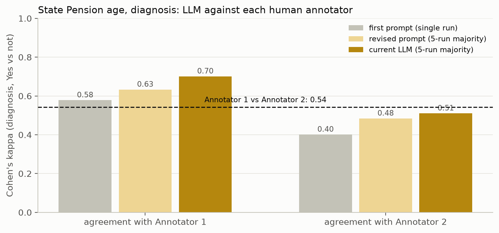

# State Pension age, diagnosis: current pipeline against the human annotations

_2026-10-14. Numbers from `compare.py` (`summary_numbers.txt`); no LLM calls._

## What was compared

- **Humans:** the two annotators' diagnosis calls in `annotations/comparisons.csv`, plus the final consensus they reached after discussing their disagreements.
- **Model:** the diagnosis sentences from the five State Pension age runs of the current pipeline (`results/state_pension_age_rep1`–`5`, Claude Sonnet 5.5, 14 October). These are the same runs used in the reproducibility figures.
- **Matching the sentences:** both sets come from the same PDF, but the human study used an older sentence split. `align.py` matches each human sentence to the current sentences covering the same text: 414 of 417 match. The other 3 are table rows, which the current extraction leaves out. A sentence the humans saw as one, but which the pipeline splits in two, counts as extracted if either part was.
- **Scale:** everything is Yes against not-Yes, so "Maybe" counts as not-Yes, as in the binary analysis in `agreement_analysis.ipynb`.

## Findings

**1. The current pipeline agrees with each annotator at least as well as the two annotators agree with each other.**

| Comparison | Cohen's kappa | Agreement |
|---|---|---|
| Annotator 1 vs Annotator 2 (human baseline) | 0.54 | 84% |
| Model (5-run majority) vs Annotator 1 | **0.70** | 90% |
| Model (5-run majority) vs Annotator 2 | 0.51 | 82% |
| Model (5-run majority) vs final consensus | 0.61 | 87% |

- **Single runs give the same picture:** against Annotator 1, kappa is 0.66–0.71 per run; against Annotator 2, 0.50–0.53.
- **The model has improved at each design step:** first prompt 0.58 / 0.40 (against Annotator 1 / Annotator 2), revised prompt 0.63 / 0.48, current pipeline 0.70 / 0.51.
- **It is consistent with itself:** the runs agree with each other at kappa 0.93 on these sentences, and 95% of sentences get the same call in all five runs. Its disagreement with the humans is therefore a steady difference of judgement, not noise.

**2. On the sentences the humans disagreed about, the model is as good a guide to the final consensus as either annotator.** There are 63 resolved sentences where one annotator said Yes and the other did not. The final consensus sided with Annotator 1 on 52%, with Annotator 2 on 48%, and with the model's majority call on 57%.

**3. Where the humans agreed, the model matches them 93% of the time.** On the 348 sentences where Annotator 1 and Annotator 2 gave the same call, the model differs on 25:

- **It adds 19 sentences both humans left out.** Almost all are historical or structural background:
  - the legislative history of State Pension age changes (S0168–S0183);
  - how the old age dependency ratio has moved (S0228–S0231);
  - how the State Pension is funded (S0011).

  Earlier prompts added the same group. It matches the "Historical context" category in the human disagreement notes, so it reflects a different reading of what counts as diagnosis, not a random error.
- **It drops 6 sentences both humans included,** mostly forward-looking statements about costs and the effects of raising State Pension age (e.g. S0081, S0117, S0327). These sit on the boundary between diagnosis and proposal.

**4. Core themes make diagnosis slightly more precise without losing much.** Of the sentences extracted as diagnosis, 59–65% are ones the final consensus marked Yes; of those placed in core themes, 64–72% are. The core sentences recover 68–76% of the consensus-Yes sentences, against 72–76% for everything extracted.

**5. Sanity checks:** all five runs pass `sanity_checks.txt`. They flag all 7 "must identify" sentences and none of the 7 "must not identify". The earlier designs passed 4/6 and 5/6.

## Caveats

- One document and one aspect: the human study covers diagnosis only.
- Two annotators, so the human baseline is a single pair. The final consensus was set by the same two people, so their agreement with it (kappa 0.77 for Annotator 1, 0.76 for Annotator 2) is not independent and isn't a fair comparison for the model.
- The earlier-design bars use the original sentence split (417 sentences) and are taken from `agreement_analysis.ipynb`. The current-pipeline bars use the 414 matched sentences. Re-computing Annotator 1 vs Annotator 2 on the 414 gives 0.543 against 0.542 before, so the matching doesn't move the human baseline.
