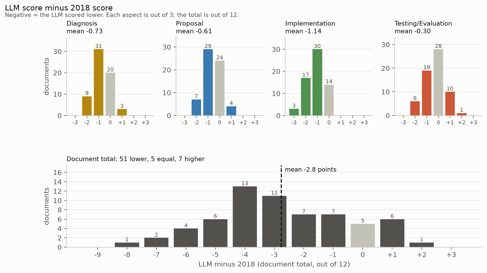
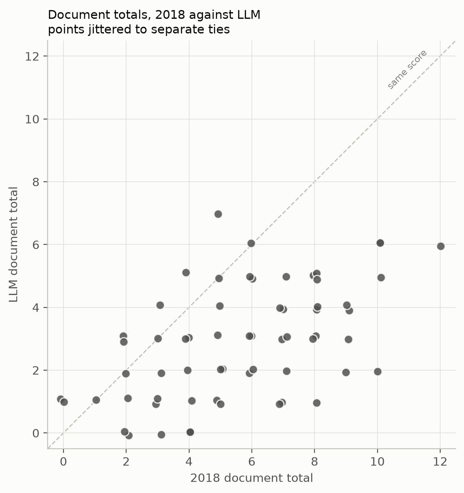
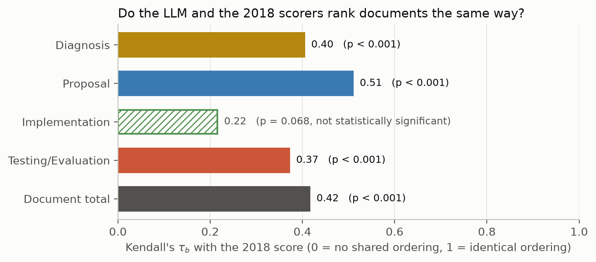
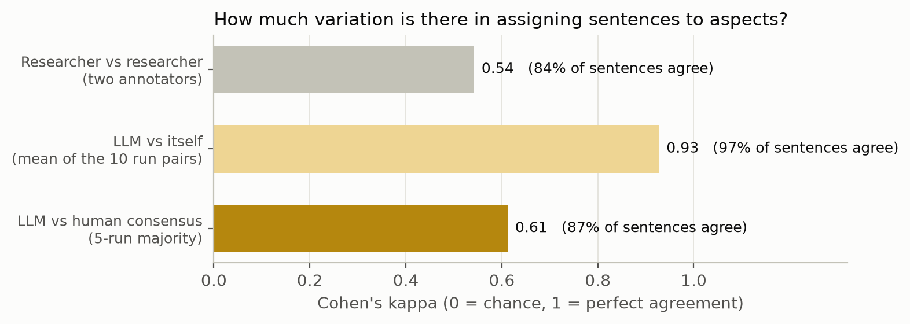
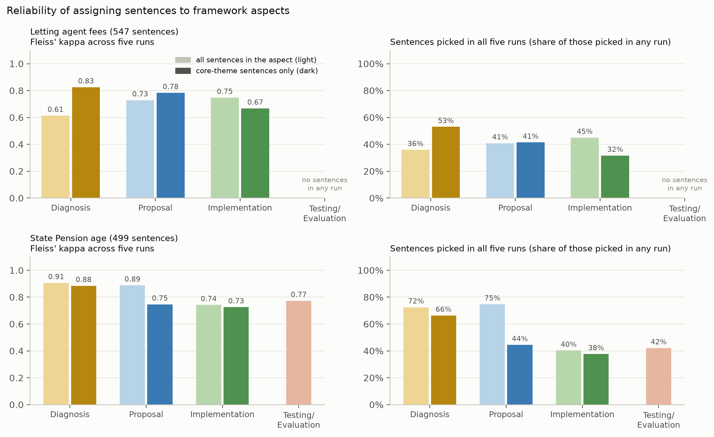
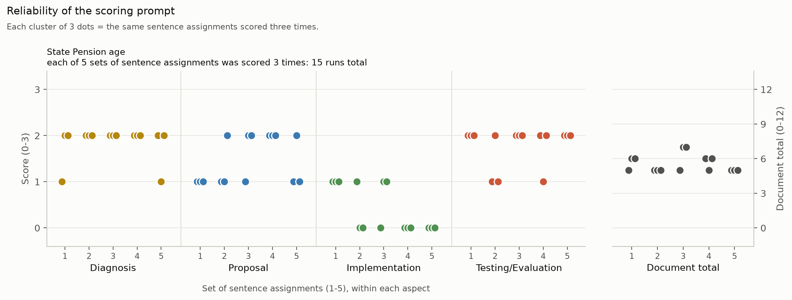
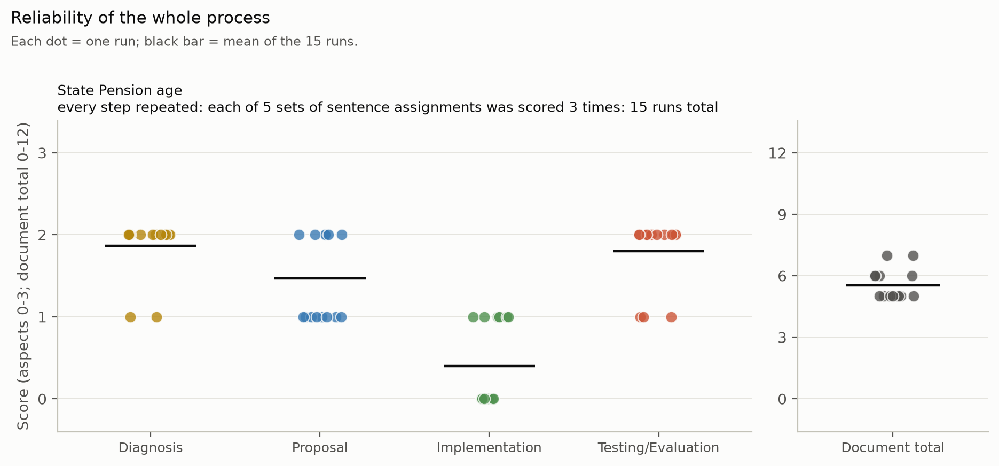

# A new LLM powered tool for evaluating evidence transparency

_Policy papers can now be scored as soon as they are published without relying on labour-intensive scoring exercises._

---

## Overview
In 2015, the (then) National What Works Advisor, David Halpern, asked whether it was possible to develop a tool to assess how transparent government departments were regarding the evidence underpinning their policies. A cross institutional effort produced the Evidence Transparency Framework[^1] which provides a means of scoring policy documents for how transparent they are regarding the evidence base across four aspects:  

**Diagnosis**: the problem the policy aims to address 

**Proposal**: the chosen intervention 

**Implementation**: how the chosen intervention will be delivered 

**Testing and Evaluation**: how the success of the chosen intervention will be assessed 

Each aspect is assigned a score (from 0 to 3) based on set criteria, including whether evidence is mentioned, citations are present, and uncertainties about the evidence are discussed. 

Sense about Science have run exercises in which volunteers use the Framework to assess the policies of government departments. The aim is to use the resulting scores to incentivise government departments to improve their use and communication of evidence. 

If policy documents can be scored as soon as they are published, and at a scale where every published document can be scored, the incentive to be clear about the use of evidence will be much greater.

To achieve this, we have developed a prototype LLM-powered pipeline that processes PDFs and government webpages and assesses the text against the Evidence Transparency Framework. This solves the scalability problem and moves us closer to a real-time league table of government departments and a stronger incentive for better use of evidence in policymaking.

## Methods

The pipeline features four stages: preprocessing, classification into aspects, classification into themes and scoring. We use Claude Sonnet 5.5 and Claude Haiku 5.5 models[^2]. The prompts and additional code can be found on [GitHub](https://github.com/RD-alpha/evidence-transparency).

### Preprocessing
The document is split into sentences and all references are extracted. Each sentence is assigned a sentence code. 

### Classification into aspects
<!--* Single prompt preferred due to context requirements
* Few Shot learning
* False negatives here are worse than false positives -->
The first step using a LLM asks the model (Sonnet) to classify each sentence as pertaining to diagnosis, proposal, implementation, testing or none. The model sees the whole document when making this assignment. The use of sentence codes means that when the LLM assigns a sentence, it is not required to reproduce sections of the document. This means we can reconstruct relevant parts of the document using only verbatim text.

### Classification into themes
Looking at the whole document, the LLM (Sonnet) is tasked with identifying _2-4 core themes_ that the argument of the policy document rests on for the diagnosis, proposal and implementation aspects. After this, the LLM (Haiku) is asked to assign each sentence in those aspects to either a core theme, or a new set of supporting themes. Since there is typically less text relating to testing, this aspect is not divided into themes.

### Scoring
Each aspect has its own scoring call. The model is given as a list of sentences grouped by theme along the references supporting each theme. The LLM (Sonnet) is asked to score each theme and then produce its final score as a mean of the scores of core themes as well as providing reasoning for its assessment. For the testing and evaluation aspect, it is asked to score all the relevant text.

This provides four scores, one for each aspect.

## Performance
To see whether the LLM was effective at applying the framework, we ran the documents featured in the Evidence Transparency Spot Check exercise from 2018[^3]. 

We tested on 64 documents, fewer than the 94 originally scored as some of the referenced content was no longer accessible. We analysed agreement in two ways, first by straightforwardly comparing the scores and second by comparing whether the human scorers and the LLM would rank documents the same way.

### Absolute agreement
The LLM tool consistently marked documents lower than human scorers. 

This was particularly profound for the implementation aspect of the policy, with scores dropping by more than one on average and in three cases there was a drop from 3 to 0. Testing showed best agreement although this can be explained by this being the lowest scoring aspect, where 20 out of the 93 documents scored zero according to the 2018 report.

{width=100%}

<!-- -->
83% of all 255 aspect scores were within one point of the 2018 assignment and 34% were in exact agreement. 

### Does it show the same trend?

Even though the absolute scores may not match, we calculated the Kendall tau-b value[^4], a statistical test to see whether the human scorers and the LLM rank the documents in a similar way. Across diagnosis, proposal, testing and document total scores, the p-value[^5] shows that it is overwhelming unlikely that the scores were ordered similarly by chance. Once again implementation shows up as an outlier with the lowest Kendall tau-b measure and the highest p-value.

{width=100%}

The reasonable agreement for the document totals is encouraging for the use of this tool to establish a ranking.

### What accounts for the difference?

The benefit of separating the scoring into subtasks is that we can audit the LLM's reasoning at the level of themes, sentences and judgements about references.

#### 1. Humans mark more positively
The necessary conditions to reach high scores are stringent when the framework is interpreted literally. It is a design feature of the tool that while it takes advantage of the ability of LLMs to deal with edge-cases, there is limited flexibility in how the framework should be applied. 

This is most evident in the consistent low scores the LLM gives for the implementation aspect. To establish clear, reproducible boundaries, we have encoded the definition of implementation referring to "how the policy will be rolled out", as described in the framework. This concerns timetables, authorities responsible, and the chosen legal route (primary/secondary legislation, publishing guidelines etc.). These aspects of policy are rarely backed up by evidence. In this respect, the LLM is likely responding to a literal reading of the framework but not replicating the interpretation of human scorers.

A good example of this is _Extending first MOT date_[^6], where, as mentioned in the spot-check report, human scorers rewarded transparency about the purpose of the document.

>At this stage, we are only seeking feedback on the principle of this approach, with implementation at a later stage when we look at MOT fee reform more broadly.

This was awarded a 3 in the implementation aspect on the ground that it showed clear use of evidence. By contrast, the LLM made the following comment in its reasoning, awarding the implementation aspect 0:

>The document says it is "only seeking feedback on the principle" and will consult later, but it gives no evidence and no method for deciding the detail. 

It is important to note that the reference point for a "good score" under this tool is not the same as for 2018 spot-check. Under the strict application of the rubric, it may be excessive for a document to contain the analysis required of the document. There is scope for a human scorer to mark contextually but the LLM is deliberately given rigid guidelines for reproducable and comparable results.

#### 2. Boundaries between aspects can be unclear

Often the distinction between aspects is not clear-cut. This became apparent to us when we attempted to annotate a policy document ourselves (see above). Our approach is particularly sensitive to this as the LLM scores by only looking at sentences assigned to an aspect and each sentence forms part of only one aspect. This ensures that we can trace its reasoning as well as reducing the token usage. To a human scorer, it is possible to see the document as a whole.

##### Example: Litter fines[^7]

>In our Litter Strategy for England, published alongside this consultation, we make a commitment to promote transparency and accurate reporting of enforcement action. [...] We believe that in principle all data held and managed by councils should be made available to local people unless there are specific sensitivities (e.g. protecting vulnerable people, or commercial and operational considerations) to doing so

This document contained text concerning a statutory duty for councils to report on their income from fines. The LLM interpreted this as part of the implementation details of the policy. To a human scorer, it is likely that this will have been considered a measure for the testing and evaluation of the policy.

#### 3. Documents can describe more than one policy
When conducting the 2018 spot check, researchers at Sense about Science identified there was some ambiguity about documents that contained more than one policy proposal and it is possible that different scorers resolved this differently. 

##### Example: Unexplained Wealth Orders[^8]
The LLM gives a score of 2 for testing with the following reasoning:

>[...] Para 3.3 says "Quantitative and qualitative metrics to assess the impact of these actions will be developed". It names the outcome areas (Pursue, Prevent, Protect) and example measures: prosecution, asset recovery and disruption statistics, changes in criminals' and professionals' behaviour, and public and private sector understanding of the threat. That outlines the process for developing success measures. Evaluation plans are also given. The Criminal Finances Board oversees effectiveness (3.4), with input from the Financial Sector Forum. The Terrorist Finance Board monitors delivery (3.5). There is a dated timetable: a baseline assessment by summer 2016, a National Risk Assessment update in 2017, a second NRA ahead of the FATF Mutual Evaluation in 2017/18 or 2018, and "Its impact will be fully evaluated on completion". The strongest counter-example to Level 2 is that no testing or piloting is described, and no reason is given for omitting it. The measures are also not yet defined. Against Level 3, the extract does not explain why these evaluation methods were chosen. It does not say what will happen to the results, and it makes no commitment to publish them. Several lines are vague, such as "keep under review". To reach Level 3 the document would have to justify its evaluation approach, state whether and when the findings will be published, and say how the results will inform later policy. It should also say whether testing was considered.

This document was particularly interesting because despite the trend for the LLM to give lower scores, the 2018 report gave it a score of zero for testing. This could have been because the Unexplained Wealth Order policy formed part of a wider Anti-Money Laundering Action Plan and the testing approaches identified by the LLM are wider money laundering tracking measures not specific to Unexplained Wealth Orders.

## Reliability  
To ensure the tool is useful, we needed to see how consistently it would mark the same document is the pipeline were run again. LLMs are inherently noisy, however if the prompts were sufficiently clear they should reach the same conclusions every time.

### How reliable is at extracting sentences?
The reliability of this step is crucial because all downstream analysis depends on sentences being grouped into aspects correctly. Some noise in this step is expected, but for the tool to work well the _core_ sentences should be extracted consistently and all relevant references need to be identified. 

To get a benchmark value of how much variability is expected from human scorers, two members of our team independently assigned all sentences pertaining to diagnosis in _State Pension age changes_[^9]. While percentage agreement is high, we need to account for the possibility that the raters agreed by chance by using the Cohen's kappa measure that goes from -1 (perfect disagreement) to 1 (perfect agreement). The two human scorers' assignments corresponded to a kappa value of 0.54. We ran the aspect classification five times and on average the LLM had a Cohen's kappa value with its other runs of 0.93. In other words, the LLM showed high consistency between runs.
Importantly, it also agreed with the consensus view of the two human raters better than the humans agreed with one another.

{width=100%}

The Fleiss' kappa is a measure of how multiple annotators (in this case different runs of the LLM call) agree. As an example, we ran the aspect classification task on _Letting agents fees_[^10] in addition to the document previously and compared how much overlap there was between the runs. 

{width=100%}

The extent of variation depends on the document in question and these documents were chosen because they had high scores without being long, allowing them to be rerun at low cost.

### How reliable is it at scoring?
The pipeline may also draw different scoring conclusions from the same sentences given to it as input. We tested this by running the scoring five times from a single set of sentence assignments. No scores moved by more than 1 point for an aspect, and no document total scores moved by more than 1 point out of a possible of 12.

{width=100%}

### How reliable is it across the whole pipeline?
Even though the two components discussed above may be reproducible, the combined noise from the two steps could result in more significant deviation from run to run. We tested this by running the scoring for each of the five sets of annotated sentences we had investigated previously.

{width=100%}

## What next?
The pipeline we have developed offers valuable insight into the use of evidence in policy documents applies the framework in a way that uncovers similar trends to human scorers. Now that we have verified this on existing data, we would like to score a set of recent policy papers. 

_Last updated: 2026-10-14_

[^1]:https://senseaboutscience.org/transparency-of-evidence/transparency-assessments/
[^2]: Preliminary testing has been done using other LLMs.
[^3]:https://senseaboutscience.org/activities/transparency-evidence-spot-check
[^4]: https://en.wikipedia.org/wiki/Kendall_rank_correlation_coefficient
[^5]: https://en.wikipedia.org/wiki/P-value
[^6]:https://www.gov.uk/government/consultations/extending-first-mot-date-to-4-years
[^7]:https://consult.defra.gov.uk/environment/reducing-litter-proportionate-enforcement
[^8]: https://www.gov.uk/government/publications/action-plan-for-anti-money-laundering-and-counter-terrorist-finance  
[^9]: https://www.gov.uk/government/publications/state-pension-age-review-final-report
[^10]:https://assets.publishing.service.gov.uk/media/5a82d97fe5274a2e87dc34ab/Banning_letting_agent_fees_paid_by_tenants_consultation.pdf
